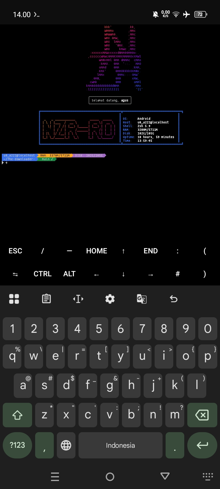
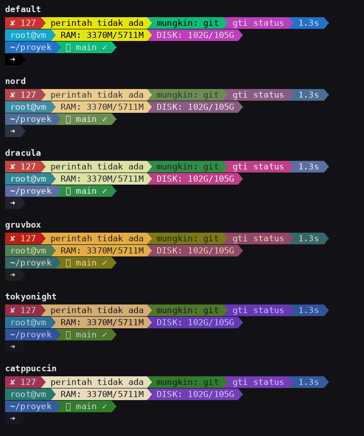

# 🚀 terminal-nzr-theme

Tema prompt **Zsh** yang cepat, cantik, dan pintar. Dibuat untuk **Termux (Android)**, dan berjalan juga di **Linux** dan **macOS**.

> **v3.0:** prompt muncul **instan** (git/RAM/DISK dihitung di latar belakang), **6 tema warna** truecolor, baris **error cerdas** dengan saran perbaikan, perintah **`fix`**, **insight** kebiasaan terminal, dan **tes otomatis**.

---

## 📸 Preview



Prompt 4 baris: baris error di atas, lalu tiga baris klasik.

```
 ✘ 127 ▶ perintah tidak ada ▶ mungkin: git ▶ gti status ▶ 1.3s ▶    ← error line (BARU)
 root@host ▶ RAM: 3370M/5711M ▶ DISK: 102G/105G ▶                   ← status
 ~/proyek ▶  main ✗3 ▶                                              ← dir + git
▶ ➜ ▶                                                                ← input
```

### Tema warna (`nzr theme`)



---

## ✨ Fitur

| | |
|---|---|
| ⚡ **Prompt async** | Prompt langsung tampil; status git (`✓`/`✗N`), RAM, dan DISK menyusul di latar belakang tanpa mengganggu ketikanmu. |
| 🎨 **Tema truecolor** | `nzr theme dracula` · nord · gruvbox · tokyonight · catppuccin. Otomatis jatuh ke 256 warna di terminal lama. Semua palet lolos uji kontras. |
| 🧯 **Baris error cerdas** | Kode exit + artinya, saran typo (`gti` → `git`), `chmod +x` untuk file tak executable, pipeline gagal, gagal beruntun `×3`, durasi, jobs. |
| 🔧 **`fix`** | Salah ketik? Ketik `fix`: perintah yang benar langsung muncul di baris input, tinggal Enter. |
| 📊 **`nzr stats`** | Perintah terbanyak, yang sering gagal, yang paling lambat, jam tersibuk. Privat: hanya nama perintah. |
| 🔔 **Notifikasi** | Build/download panjang selesai → notifikasi (Termux, Linux, macOS). |
| 🔒 **Privasi** | Token/password disaring dari log dan `HISTFILE`. File data berizin `600`. |
| 🩺 **`nzr doctor` `bench` `demo`** | Diagnosis, pengukuran biaya prompt, pratinjau semua tampilan. |
| 🧰 **Fungsi bantu** | `mkcd` · `up` · `bak` · `extract` |

---

## 📥 Instalasi

```bash
git clone https://github.com/nzr-rd/terminal-nzr-theme.git
cd terminal-nzr-theme
bash install.sh
exec zsh
```


Lepas theme: `bash install.sh --uninstall` (hanya dua baris milik theme yang dihapus dari `.zshrc`, dengan cadangan).

### Font
Simbol powerline butuh **Nerd Font / Powerline font**. Jalankan `nzr font` untuk mengetesnya dan melihat cara memasang di OS-mu. Termux umumnya sudah menampilkannya dengan benar.

---

## 🧭 Dukungan platform

| Platform | Status |
|---|---|
| **Android Termux** | Target utama |
| **Linux** (Debian/Ubuntu/Arch/Fedora/…) | Diuji, zsh ≥ 5.0 |
| **macOS** | Tes otomatis dijalankan di CI (`.github/workflows/tests.yml`); RAM dibaca dari `vm_stat`; notifikasi lewat `osascript`; tema memakai 256 warna di Terminal.app |
| **Windows** | Lewat **WSL** (sama seperti Linux). PowerShell/CMD tidak didukung |
| **Shell lain** | Hanya zsh. `display.sh` otomatis pindah ke zsh bila dijalankan dengan bash |

---

## ⚡ Cara kerja prompt async

Dulu tiap prompt memanggil `free`, `df`, `awk`, dan `git` lalu **menunggu**. Sekarang:

1. Prompt digambar langsung dengan data terakhir yang diketahui.
2. Nama branch dibaca dari `.git/HEAD` tanpa membuat proses baru.
3. Satu worker latar belakang menghitung status git, RAM, DISK.
4. Selesai → prompt digambar ulang di tempat (`zle reset-prompt`), teks yang sedang kamu ketik tetap utuh.

Hasil pengukuran (git sengaja dibuat lambat 1 detik): prompt lama baru muncul setelah **1,04 detik**, prompt async dalam **0,05 detik**, lalu `✗3` menyusul. Jalankan `nzr bench` untuk mengukur di perangkatmu.

Tampilan tiga baris **identik** dengan versi sebelumnya; ini dibuktikan tes golden byte-per-byte (`tests/fixtures/orig_prompt.zsh`). Selama status git belum selesai, segmen git tampil kuning (`main …`).

Matikan kapan saja: `nzr set ASYNC_PROMPT OFF`.

---

## 🧯 Baris error

| Tampilan | Arti |
|---|---|
| `✓ ok` | perintah terakhir sukses |
| `✘ 127 · perintah tidak ada · mungkin: git` | typo; `fix` memperbaikinya |
| `✘ 126 · tidak bisa dieksekusi · coba: chmod +x` | file ada tapi belum executable |
| `✘ 130 · dihentikan (Ctrl+C)` | sinyal dari nama sinyal, akurat di Linux dan macOS |
| `✘ 137 · di-kill (SIGKILL)` | mis. kehabisan RAM |
| `✘ 1 ×3` | gagal 3 kali berturut-turut |
| `⚠ pipe 1\|0` | ujung pipeline sukses tapi ada bagian yang gagal |
| `jobs 2` · `1m14s` · `23:53:04` | job latar belakang · durasi · jam selesai |

Di layar sempit (Termux portrait) segmen yang kurang penting dibuang lebih dulu; saran perbaikan dipertahankan paling akhir.

---

## 🛠 Perintah `nzr`

```
nzr help               semua perintah
nzr doctor             cek dependensi, locale, font, izin, notifikasi, uji display.sh
nzr theme [NAMA]       lihat / ganti tema warna
nzr stats [hari|all]   insight pemakaian  (nzr stats clear = hapus)
nzr bench              ukur biaya tiap komponen prompt
nzr last               detail perintah terakhir
nzr demo               pratinjau semua tampilan baris error
nzr config             semua pengaturan aktif
nzr set KEY NILAI      ubah pengaturan (langsung aktif + tersimpan)
nzr font               tes simbol powerline
nzr notify-test        uji notifikasi
nzr update             git pull
fix                    perbaiki perintah terakhir yang gagal
```

`nzr set` hanya menerima opsi yang dikenal dan nilai yang tervalidasi, sehingga `config.sh` (yang di-source oleh shell) tidak bisa disisipi perintah.

---

## 🔒 Privasi dan keamanan

- **`nzr stats`** mencatat HANYA: waktu, kode exit, durasi, dan **nama** perintah (kata pertama, tanpa argumen, path, URL, atau token). Disimpan lokal di `~/.local/share/nzr` (folder `700`, file `600`), tidak pernah dikirim ke mana pun. Matikan: `nzr set STATS_LOG OFF`. Hapus: `nzr stats clear`.
- Log autosuggestions dan `HISTFILE` menyaring perintah berisi token, password, `Bearer`, API key (`ghp_`, `sk-`, `AKIA…`), dan URL `user:pass@`. Perintah itu masih bisa dipanggil lagi dengan panah atas selama sesi berjalan.
- Teks perintah yang gagal dan judul terminal dibersihkan dari escape sequence (tidak ada eksekusi `$(...)` atau injeksi kontrol terminal).
- Installer tidak menimpa baris `.zshrc` milikmu; hanya dua baris theme.

---

## ⚙️ Kustomisasi

Semua opsi ada di `config.sh`, dan semuanya bisa diubah dengan `nzr set`. Lihat daftar lengkap: `nzr config`.

| Opsi | Nilai | Fungsi |
|---|---|---|
| `NZR_THEME` | `default` `nord` `dracula` `gruvbox` `tokyonight` `catppuccin` | tema warna |
| `NZR_COLOR_DEPTH` | `auto` `truecolor` `256` | paksa kedalaman warna |
| `ASYNC_PROMPT` | `ON`/`OFF` | prompt async |
| `SHOW_ERROR_LINE` | `ON`/`OFF` | `OFF` = kembali ke 3 baris |
| `ERROR_LINE_MODE` | `always`/`error` | `error` = baris error hanya saat gagal |
| `ERROR_SUGGEST` `ERROR_SHOW_CMD` `ERROR_SHOW_JOBS` `ERROR_SHOW_TIME` | `ON`/`OFF` | isi baris error |
| `SHOW_CMD_DURATION` `CMD_DURATION_MIN` | `ON`/`OFF`, detik | durasi perintah |
| `NOTIFY_LONG_CMD` `NOTIFY_MIN_SECONDS` | `ON`/`OFF`, detik | notifikasi perintah lama |
| `STATS_LOG` `HIST_SCRUB` | `ON`/`OFF` | statistik lokal, penyaringan history |
| `SET_TITLE` `EXTRA_TOOLS` | `ON`/`OFF` | judul tab, fungsi bantu |
| `SHOW_LOGO` `SHOW_HEADLINE` `SHOW_USER_INFO` `SHOW_SYSTEM_INFO` `HEADLINE_*` `USER_NAME` `WELCOME_MSG` `AUTO_GREETING` `SHOW_TIPS` | | tampilan startup (`rd` untuk melihat) |
| `AUTOSUGGESTIONS` `SYNTAX_HIGHLIGHTING` `BATGIT_INTEGRATION` | `ON`/`OFF` | plugin |

---

## ✅ Tes

```bash
zsh tests/run.zsh
```

Tanpa dependensi selain zsh, git, dan awk. Yang dijaga:

- tiga baris prompt **identik byte-per-byte** dengan v2.0
- arti kode exit, format durasi, saran typo, perilaku layar sempit
- validasi `nzr set` (termasuk upaya injeksi), penyaringan rahasia, izin file
- **kontras WCAG** tiap palet (teks putih/merah/magenta/biru ≥ 4,5:1; hijau/cyan ≥ 3:1)
- konversi truecolor → 256 warna, parser `vm_stat` macOS
- mesin async (worker, cache, git worktree), `fix`, `nzr stats`, notifikasi
- uninstall hanya menghapus baris milik theme

CI (GitHub Actions) menjalankan tes yang sama di Ubuntu dan macOS pada setiap push.

---

## 🗂 Struktur

```
nzr.zsh            loader, definisi PROMPT, hook
config.sh          semua pengaturan
display.sh         tampilan startup (bisa dijalankan lewat bash/zsh)
install.sh         installer universal (--uninstall)
lib/prompt.sh      mesin prompt async: kolektor, render, worker
lib/errorline.sh   baris error: arti kode, saran typo, segmen
lib/theme.sh       tema warna truecolor/256
lib/insights.sh    fix, nzr stats, nzr bench
lib/notify.sh      notifikasi perintah lama
lib/privacy.sh     penyaring rahasia
lib/cli.sh         perintah nzr
lib/tools.sh       mkcd, up, bak, extract
tests/             test suite + fixture golden
```

---

## 📝 Catatan perubahan v3.0

- **Baru:** prompt async · tema warna · `fix` · `nzr stats` · `nzr bench` · `nzr font` · tes otomatis + CI · `install.sh --uninstall`
- **Diperbaiki:** installer tidak lagi menghapus baris `.zshrc` di luar blok theme; `sudo bash install.sh` tidak lagi memasang ke HOME root; folder theme terdeteksi benar dari folder mana pun shell dibuka; file log berizin `600`; RAM macOS terbaca; `display.sh` berjalan lewat bash.
- **Tidak berubah:** tampilan tiga baris status / dir+git / input.

---

## 📄 Lisensi
Lihat berkas [LICENSE](LICENSE).
